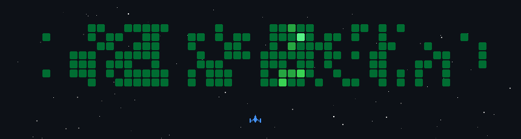

<!-- Header Wave with Text Overlay -->
<div align="center" style="position: relative; width: 100%;">
  
  <!-- <div style="position: absolute; top: 50%; left: 50%; transform: translate(-50%, -50%); text-align: center; color: white; text-shadow: 2px 2px 8px rgba(0,0,0,0.8);">
    <h1 style="font-size: 3.5em; margin: 0; font-weight: bold;">Sachin Mehar</h1>
    <p style="font-size: 1.5em; margin: 10px 0 0 0;">Full-Stack Developer | MERN Specialist</p>
  </div> -->
</div>

<p align="center">
  
</p>
<!-- <br/>
<p align="center">
  
</p>
<br/> -->


<!--
<p align="center">
  <a href="https://git.io/typing-svg">
    
  </a>
</p>
-->

<!-- Name & Role -->
<h1 align="center">Abhay Sanjay Ghongade</h1>
<p align="center">Software Developer &nbsp;|&nbsp; Java Full Stack Developer</p>


<!-- Profile Badges -->
<div align="center">
  <a href="https://github.com/abhayxxmm1" target="_blank">
    </a>
  <a href="https://github.com/abhayxxmm1?tab=repositories&sort=stargazers" target="_blank">
    <!-- </a> -->
  <a href="https://github.com/abhayxxmm1?tab=followers" target="_blank">
    </a>
</div>

<br/>

<!-- About Me Section with GIF -->


<h2>About Me</h2>

```javascript
const abhay = {
  location: "Maharashtra, India 🇮🇳",
  role: "Software Developer | Java Full Stack Developer",
  workingOn: "Building scalable web applications",
  learning: "Spring Core, MVC, Boot & AI",
  askMeAbout: ["JAVA", "SQL", "PLSQL", "APIs"],
  funFact: "I debug a lot 🐛",
};
```

- Portfolio: [Link](https://abhays-portfolioo.netlify.app/) 

- 🔭 I’m currently working on [Spring](https://github.com/abhayxxmm1/j2ee-)

- 🌱 I’m currently learning **Microservices, AI, Docker, k8s**

- 🤝 I’m looking for help with **System Design**

- 💬 Ask me about **JAVA, SQL, PLSQL, JS, React**

- 📫 How to reach me: **ghongadeabhay60@gmail.com**

- ⚡ Fun fact: **I like Anime a lot and love to play chess**

- Chess.com: [https://www.chess.com/member/abhayxxmm1](https://www.chess.com/member/abhayxxmm1)

<br clear="both"/>

---

<!-- Connect Section -->
<h2 align="center">Connect With Me</h2>
<div align="center">
  <a href="https://twitter.com/abhayxxmm1" target="blank"></a>
  <a href="https://linkedin.com/in/abhay-ghongade" target="blank"></a>
  <a href="https://instagram.com/abhayxxmm1" target="blank"></a>
  <a href="https://www.youtube.com/channel/UCjnyFNrJeu1LRL-n7YL1Kcw" target="blank"></a>
  <a href="https://www.leetcode.com/abhayxxmm1" target="blank"></a>
  <a href="https://www.chess.com/member/abhayxxmm1" target="blank"></a>
</div>

<!-- --- -->

<!-- GitHub Stats Section -->
<!-- <h2 align="center">GitHub Statistics</h2>
<div align="center">
  
  
</div>
</div> -->


<!-- <br/> -->

<!-- Activity Graph -->
<!-- <div align="center">
  
</div>

<br/>

--- -->

<!-- Tech Stack Section -->
<h2 align="center">Tech Stack & Tools</h2>

<h4 align="center">Languages</h4>
<div align="center">
  
  <br/>
  
</div>

<h4 align="center">Backend</h4>
<div align="center">
  
  <br/>
  
  
  
  
  
  
  
  
</div>

<h4 align="center">Frameworks & Libraries</h4>
<div align="center">
  
</div>

<h4 align="center">Databases & Cloud</h4>
<div align="center">
  
  <br/>
  
  
  
</div>

<h4 align="center">DevOps</h4>
<div align="center">
  
  <br/>
  
</div>

<h4 align="center">Tools & Platforms</h4>
<div align="center">
  
</div>

<br/>

---

<!-- Detailed Tech Badges -->
<h2 align="center">Technology Expertise</h2>
<div align="center">
  
  
  
  
  <!--  -->
  
  <!--  -->
  
  <!--  -->
  
  
  
  
  <!--  -->
  
  <!--  -->
  
  
  
  
  
</div>

<br/>

<!-- --- -->

<!-- Featured Repositories -->
<!-- <h2 align="center">⭐ Featured Projects</h2>

<div align="center">
  <a href="">
    
  </a>
  <a href="">
    
  </a>
</div>

<br/>

<div align="center">
  <a href="">
    
  </a>
  <a href="">
    
  </a>
</div> -->

<!-- Featured Projects (replace each REPO-NAME with the real repository name) -->
<h2 align="center">Featured Projects</h2>

<div align="center">

| Project | Stack | Description |
| :-- | :-- | :-- |
| **[Alma Orb – Alumni Portal](https://github.com/abhayxxmm1/REPO-NAME)** | React.js, Node.js, Express.js, MongoDB, JWT | Alumni networking and management platform |
| **[Employee Management System](https://github.com/abhayxxmm1/REPO-NAME)** | Spring MVC, Hibernate/JPA, JSP, JSTL, PostgreSQL | Employee CRUD and management operations |
| **[Property Management Database System](https://github.com/abhayxxmm1/REPO-NAME)** | Oracle SQL, PL/SQL | Database-driven property management system |
| **[Traffic Management Database System](https://github.com/abhayxxmm1/REPO-NAME)** | Oracle SQL, PL/SQL | Traffic monitoring and database management |
| **[Microservices-Based E-Commerce System](https://github.com/abhayxxmm1/REPO-NAME)** | Java, Spring Boot, Microservices | Scalable e-commerce backend architecture |

</div>


<br/>

---

<!-- Contribution Snake -->
<h2 align="center">Contribution Graph</h2>
<div align="center">
  <picture>
    <source media="(prefers-color-scheme: dark)" srcset="https://raw.githubusercontent.com/platane/snk/output/github-contribution-grid-snake-dark.svg">
    <source media="(prefers-color-scheme: light)" srcset="https://raw.githubusercontent.com/platane/snk/output/github-contribution-grid-snake.svg">
    
  </picture>
</div>

<!-- Space Shooter contribution animation (generated by the space-shooter workflow; check the file name matches) -->
<p align="center">
  
</p>

<!-- GitSkins sections (UNVERIFIED endpoints: GitSkins does not document /api/section/... URLs; build these at https://www.gitskins.com/readme-builder and paste the generated markup here)
<p align="center">
  
</p>
<p align="center">
  
</p>
<p align="center">
  
</p>
<p align="center">
  
</p>
-->

<br/>

<!-- --- -->

<!-- Support Section -->
<!-- <h2 align="center">☕ Support My Work</h2>
<p align="center">
  <a href="https://www.buymeacoffee.com/sachinmehar">
    
  </a>
</p> -->

<br/>

---

<!-- Quote -->
<div align="center">
  
</div>

<br/>


<!-- Footer Text -->
<!-- 

 -->


<p align="center">
  
</p>